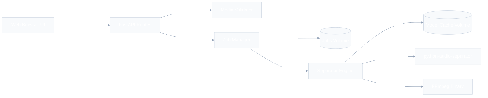

# Audio Separation Design

**Spec**: `.specs/features/audio-separation/spec.md`
**Status**: Approved

---

## Architecture Overview

Split My Music uses a clean, layered Python + FastAPI backend coupled with a lightweight static HTML/CSS/JS frontend. All `python-audio-separator` calls are isolated in `src/core/engine.py`, while `src/core/jobs.py` coordinates disk-backed job manifests, bounded concurrency, restart recovery, and retention cleanup.

---

## Components

### 1. Configuration (`src/config.py`)

- **Purpose**: Load runtime directories, limits, concurrency, and retention policies from environment variables with safe defaults.
- **Location**: `src/config.py`
- **Interfaces**:
  - `Settings` dataclass (`host`, `port`, `model_cache_dir`, `jobs_dir`, `max_upload_mb`, `max_duration_minutes`, `max_concurrent_jobs`, `max_queue_size`, `min_free_disk_mb`, `retention_hours`, `max_stored_jobs`, `chunk_duration_seconds`, `log_level`)
  - `load_settings() -> Settings`

### 2. Curated Catalog & Error Types (`src/core/catalog.py`, `src/core/errors.py`)

- **Purpose**: Define curated separation goals, verified models, output formats, track definitions, and structured user-facing errors.
- **Location**: `src/core/catalog.py`, `src/core/errors.py`
- **Interfaces**:
  - `AppError(code, user_message, suggestion, status_code=400)`
  - `get_goal(goal_id)`, `get_model(model_id)`, `get_output_format(format_id)`, `validate_model_and_outputs(model_id, outputs)`
  - `list_public_catalog(model_cache_dir)`

### 3. Media Inspection & Audio Normalization (`src/core/media.py`)

- **Purpose**: Sanitize filenames, validate extensions, probe real audio streams with `ffprobe` (`shell=False`), downmix >2 channels before inference, and export final tracks preserving mono/stereo and sample rate.
- **Location**: `src/core/media.py`
- **Interfaces**:
  - `sanitize_display_name(filename: str) -> str`
  - `validate_extension(filename: str) -> str`
  - `inspect_audio_file(file_path: Path, max_duration_seconds: int) -> AudioMetadata`
  - `prepare_audio_for_engine(input_path: Path, work_dir: Path, metadata: AudioMetadata) -> Path`
  - `finalize_output_audio(source_path: Path, dest_path: Path, target_channels: int, target_sample_rate: int, output_format: str) -> Path`

### 4. Isolated Separation Engine (`src/core/engine.py`)

- **Purpose**: Wrap `audio_separator.separator.Separator` and translate library/device/download/OOM exceptions into structured `AppError` instances.
- **Location**: `src/core/engine.py`
- **Interfaces**:
  - `detect_hardware_info() -> HardwareInfo`
  - `is_model_cached(model_id: str, model_cache_dir: Path) -> bool`
  - `AudioSeparatorEngine.run_separation(...) -> dict[str, Path]`

### 5. Job Manager (`src/core/jobs.py`)

- **Purpose**: Manage bounded background job execution, atomic JSON manifest persistence, startup recovery for interrupted jobs, ZIP creation, and safe retention cleanup.
- **Location**: `src/core/jobs.py`
- **Interfaces**:
  - `JobManager.recover_interrupted_jobs() -> int`
  - `JobManager.cleanup_expired_jobs() -> int`
  - `JobManager.submit_job(...) -> dict`
  - `JobManager.get_job(job_id: str) -> dict`
  - `JobManager.resolve_output_file(job_id: str, filename: str) -> tuple[Path, str]`
  - `JobManager.resolve_zip_file(job_id: str) -> tuple[Path, str]`
  - `JobManager.delete_job(job_id: str) -> None`

### 6. FastAPI Application & Frontend (`src/api/routes.py`, `templates/index.html`, `static/`)

- **Purpose**: Serve the studio web interface, expose JSON job/config APIs, stream uploads safely, stream outputs with range/download headers, and render clear accessible states.
- **Location**: `src/api/routes.py`, `templates/index.html`, `static/css/style.css`, `static/js/app.js`

---

## Error Handling Strategy

| Error Scenario | Handling | User Impact |
| -------------- | -------- | ----------- |
| Empty, oversized, or non-audio upload | Stream size guard + extension check + `ffprobe` validation | Clear error banner explaining format/size limits + "Choose Another File" |
| Insufficient disk space | `shutil.disk_usage` check before upload/job enqueue | HTTP 507 + actionable disk-space warning |
| Queue saturated | Bounded `max_queue_size` check under lock | HTTP 429 + prompt to wait and retry shortly |
| Model download failure | Catch download/network errors, delete 0-byte partials | Plain-English connectivity error + retry / switch model guidance |
| RAM / VRAM exhaustion | Catch CUDA/memory errors, clear GPU cache, clean temp files | Suggests lighter default model (`UVR MDX-Net Inst HQ 3`) |
| Server restart mid-job | `recover_interrupted_jobs()` on FastAPI lifespan startup | Job reports `INTERRUPTED_BY_RESTART` with clean retry option |
| Missing/empty output track | Verify every requested file exists and `st_size > 0` | Explicit `EXPORT_FAILED` error; never returns broken links |

---

## Tech Decisions

| Decision | Choice | Rationale |
| -------- | ------ | --------- |
| Background processing | `ThreadPoolExecutor` + JSON manifests | Keeps homelab deployment single-container with zero extra services |
| Audio export strategy | `audio-separator` exports intermediate `WAV`, `ffmpeg` finalizes channels/sample-rate/format | Ensures mono stays mono, input sample rates (e.g. 48 kHz) are preserved, and `WAV`/`FLAC`/`MP3` encoding is consistent |
| Frontend stack | Semantic HTML + custom CSS + modular ES6 JS | Fast load, zero build toolchain, accessible out of the box |
