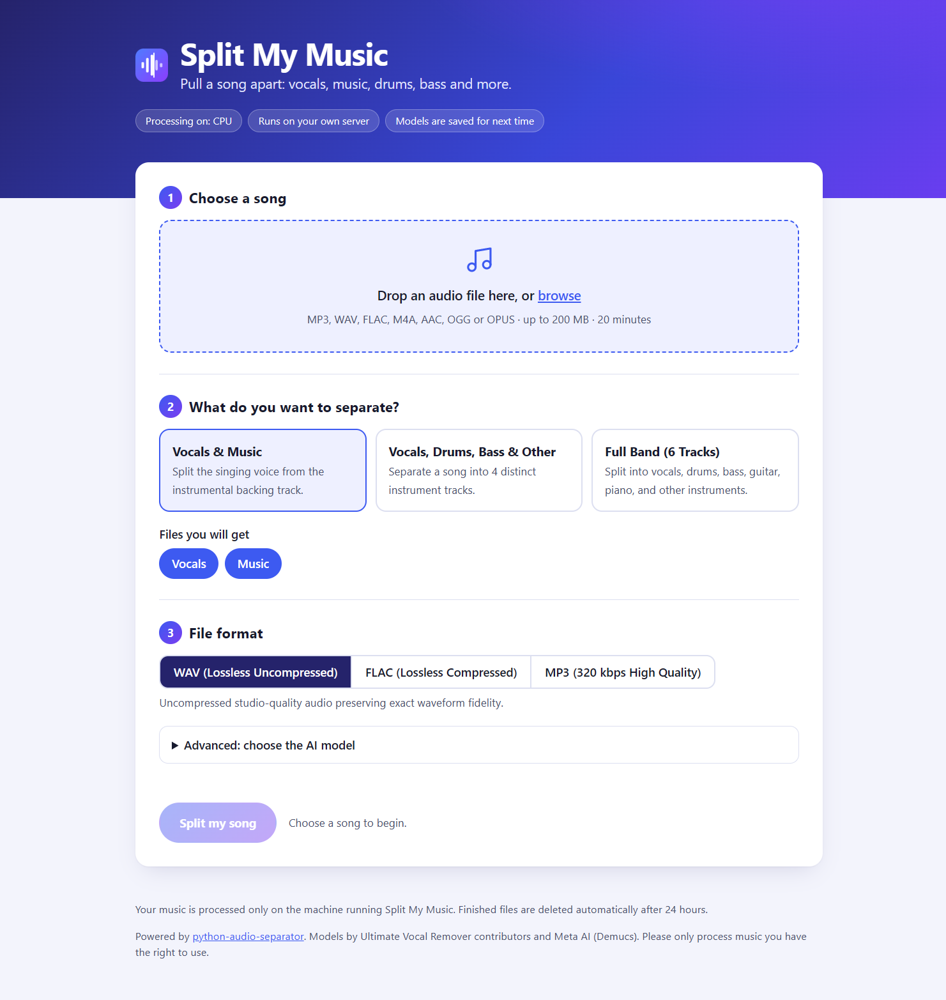
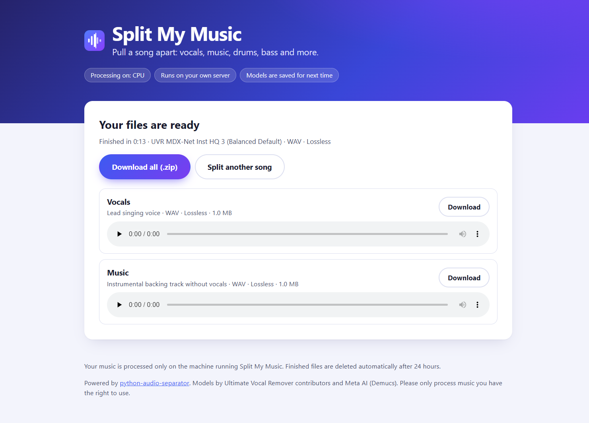

# Split My Music

> Split a song into **vocals, music, drums, bass and more** — on your own server, with a simple web page.

🇧🇷 [Leia em português](README_PT-BR.md)



Split My Music is a small, self-hosted web app. You drop in a song, pick what you want to separate, and listen to and download the result. Everything runs on the machine where you install it: **your music is never sent to a third party.** The separation itself is done by the open-source [python-audio-separator](https://github.com/nomadkaraoke/python-audio-separator) library; this project adds a friendly interface, a safe job queue, and Docker setups for CPU and NVIDIA GPU.

## Features

- Drag-and-drop upload (MP3, WAV, FLAC, M4A, AAC, OGG, OPUS).
- Three plain-English goals: **Vocals & Music**, **Vocals / Drums / Bass / Other**, **Full Band (6 tracks, adds guitar and piano)**.
- Only tracks the chosen model can really produce are offered.
- Real stage tracking (upload → prepare → get model → separate → save). No made-up progress percentage.
- Listen to each track in the page, download one by one or as a `.zip`.
- Output as **WAV** or **FLAC** (lossless) or **MP3** (320 kbps). Mono stays mono, and the input sample rate is kept (MP3 uses the nearest MP3-supported rate).
- Advanced: pick another tested model; see whether it is already downloaded and how big the first download is.
- Models are downloaded once and kept in a persistent volume.
- Safe by default: size/duration limits, one song at a time, bounded queue, disk-space check, automatic cleanup, no stack traces shown to users.
- Responsive, keyboard-friendly, screen-reader labels.



## Quick start (Docker, CPU)

```bash
git clone <this repository>
cd split-my-music
docker compose up -d --build
```

Open <http://localhost:7860>. The first run of each model downloads it (50–80 MB for the default ones).

- Models are stored in the Docker volume `model-cache`.
- Results are stored in `./data/jobs` on the host and deleted automatically after 24 hours.

## Quick start (NVIDIA GPU)

Host requirements: an NVIDIA GPU, a recent NVIDIA driver, and the [NVIDIA Container Toolkit](https://docs.nvidia.com/datacenter/cloud-native/container-toolkit/latest/install-guide.html) configured for Docker.

```bash
docker compose -f docker-compose.yml -f docker-compose.gpu.yml up -d --build
```

The override file **replaces** the CPU service, so only one container uses port 7860. Do not start the CPU and GPU variants together.

> ⚠️ **Honest status:** the GPU image and override were validated only with `docker compose config`. They were **not run on NVIDIA hardware** (nor were the Docker images built) by the author. The CPU path was tested end to end outside Docker. Please report issues. Apple Silicon, AMD and Intel GPUs are **not** supported inside these containers.

The header badge shows the device the app detected (`CPU` or `NVIDIA GPU (...)`). It reports GPU only when PyTorch can actually see CUDA.

## Update

```bash
git pull
docker compose up -d --build        # add the -f ... gpu file for GPU
```

Models and results live in volumes, so they survive updates.

## Models

Only these tested models are exposed (names as in python-audio-separator):

| Goal | Model | Files it creates | First download | Notes |
|---|---|---|---|---|
| Vocals & Music (default) | UVR-MDX-NET-Inst_HQ_3 | Vocals, Music | ~64 MB | **Tested on CPU here** |
| Vocals & Music | Kim_Vocal_2 | Vocals, Music | ~64 MB | not run in tests |
| Vocals & Music | UVR_MDXNET_KARA_2 | Vocals, Music | ~50 MB | keeps backing vocals in Music; not run in tests |
| 4 tracks | htdemucs | Vocals, Drums, Bass, Other | ~80 MB | not run in tests |
| 6 tracks | htdemucs_6s | + Guitar, Piano | ~53 MB | guitar/piano may bleed; not run in tests |
| Vocals & Music | BS-RoFormer (ep 317) | Vocals, Music | ~610 MB | very slow on CPU; GPU recommended; not run in tests |

Only the default model was actually executed in the automated tests. The others are configured from the library's own model list and file names but have not been run here. Download sizes are taken from the model hosts at the time of writing. Quality and speed were **not benchmarked**.

## Limits and formats

| Setting (env var) | Default |
|---|---|
| `SPLIT_MAX_UPLOAD_MB` | 200 |
| `SPLIT_MAX_DURATION_MINUTES` | 20 |
| `SPLIT_MAX_CONCURRENT_JOBS` | 1 |
| `SPLIT_MAX_QUEUE_SIZE` | 5 |
| `SPLIT_MIN_FREE_DISK_MB` | 500 (plus the model size if not yet downloaded) |
| `SPLIT_RETENTION_HOURS` | 24 |
| `SPLIT_MAX_STORED_JOBS` | 20 |
| `SPLIT_MODEL_CACHE_DIR` / `SPLIT_JOBS_DIR` | `./data/models` / `./data/jobs` (`/data/...` in Docker) |
| `SPLIT_HOST` / `SPLIT_PORT` / `SPLIT_LOG_LEVEL` | `0.0.0.0` / `7860` / `INFO` |

Files with more than 2 channels are mixed down to stereo before processing. If the server restarts during a job, that job is marked as interrupted and you can start it again. Cleanup only removes finished jobs older than the retention time (or beyond the stored-jobs cap), never running ones.

## Privacy and security

- Processing happens on the server where you install the app. Uploaded files are deleted as soon as a job ends; results stay until the retention time passes.
- The only outgoing network traffic is downloading model files (GitHub / model hosts) the first time a model is used.
- File names are never used as paths; no shell commands are built from user data; results are served only through job-checked URLs.
- **There is no login.** It is meant for your own computer, home network or NAS. Do **not** expose it to the internet as is. If you must, put it behind a reverse proxy with HTTPS and authentication, and review the upload limits first.
- Please only process music you have the right to use.

## Troubleshooting

- **"Model download failed"** – the server needs internet access to GitHub the first time, and enough free disk space. Try again.
- **"Not enough memory"** – use the default model or a shorter song; lower `SPLIT_MAX_CONCURRENT_JOBS` is already 1.
- **GPU badge shows CPU** – the container does not see the GPU. Check `nvidia-smi` on the host and the NVIDIA Container Toolkit.
- **"Server is busy"** – the queue is full; wait for a song to finish.
- **Container unhealthy** – `docker compose logs split-my-music`; health check is `GET /health`.
- Very slow on CPU is normal for long songs; the larger models are much slower.

## Development

Requires Python 3.12 and FFmpeg.

```bash
python3.12 -m venv .venv
.venv/bin/pip install -r requirements.txt     # Windows: .venv\Scripts\pip
.venv/bin/python main.py
```

Tests:

```bash
pytest -m "not real_model"     # fast: unit + integration with a fake engine
pytest -m real_model           # downloads ~64 MB and runs the real model on CPU
pytest                         # everything
```

Project layout: `src/core/engine.py` is the only place that talks to python-audio-separator; `catalog.py` lists the tested models; `jobs.py` runs the queue; `routes.py` is the web API. Specs live in `.specs/`.

## License and credits

Code: [MIT](LICENSE). Model weights and dependencies have **their own** licenses and are downloaded at runtime, not shipped here:

- [python-audio-separator](https://github.com/nomadkaraoke/python-audio-separator) (MIT) by Andrew Beveridge / nomadkaraoke. It asks that projects using UVR models credit UVR and its developers.
- [Ultimate Vocal Remover](https://github.com/Anjok07/ultimatevocalremovergui) by Anjok07 and aufr33 and the MDX-Net models (KimberleyJSN, Kuielab and others).
- [Demucs](https://github.com/facebookresearch/demucs) by Meta AI Research (MIT).
- BS-RoFormer implementations by lucidrains and weights by ViperX.
- FFmpeg (LGPL/GPL depending on build), PyTorch, ONNX Runtime, FastAPI.

The license notes in the app and above are a good-faith summary from upstream project pages; please verify the license of each model file before redistributing it. Inspired by the layout of [voice-separator-demucs](https://github.com/paladini/voice-separator-demucs).
