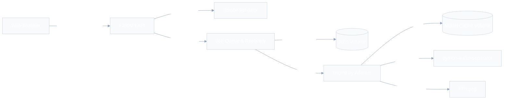

<div align="center">

# Split My Music

**Self-hosted AI audio separation — split vocals, backing music, drums, bass, guitar, and piano from any song in a clean, private web interface.**

[](https://github.com/paladini/split-my-music/actions/workflows/ci.yml)
[](https://github.com/paladini/split-my-music/actions/workflows/release.yml)
[](https://hub.docker.com/r/paladini/split-my-music)
[](https://github.com/paladini/split-my-music/releases)
[](https://www.python.org/)
[](LICENSE)

[Português (Brasil)](README_PT-BR.md) · [Docker Hub](https://hub.docker.com/r/paladini/split-my-music) · [Changelog](CHANGELOG.md) · [Security](SECURITY.md)

</div>

---


Split My Music is a lightweight, self-hosted web application powered by [`python-audio-separator`](https://github.com/nomadkaraoke/python-audio-separator). Drop in an audio file, pick a plain-English separation goal, listen to each isolated track directly in your browser, and download individual tracks or a single `.zip` bundle.

Everything runs locally on your own computer, homelab, or NAS — **your audio files never leave your server.**

## Why Split My Music?

Running open-source music source separation models usually requires memorizing CLI flags, juggling PyTorch/CUDA/ONNX wheels, and guessing cryptic model filenames. Split My Music wraps that power into three calm steps:

1. **Choose a song** — drag and drop MP3, WAV, FLAC, M4A, AAC, OGG, or OPUS files.
2. **Pick what you want to separate** — *Vocals & Music*, *Vocals, Drums, Bass & Other*, or *Full Band (6 Tracks)*.
3. **Listen & download** — preview every track in-browser and export lossless (`WAV`, `FLAC`) or `MP3` (320 kbps), individually or as a `.zip`.


## Key Features

- **Zero-jargon experience** — plain-English goals and track names (*Vocals*, *Music*, *Drums*, *Bass*, *Guitar*, *Piano*, *Other Instruments*) with an optional collapsible *Advanced* panel for model selection.
- **Accurate capabilities** — only tracks the selected model can actually produce are offered; invalid combinations are rejected cleanly.
- **Honest stage tracking** — real server-side phases (`Upload` → `Prepare audio` → `Get the AI model` → `Separate` → `Save files`) without fabricated percentage bars.
- **Persistent model cache** — models download once into a persistent Docker volume (`/data/models`) and stay cached across restarts and updates.
- **Fidelity preservation** — mono inputs stay mono, stereo stays stereo, multi-channel (>2ch) inputs safely downmix before inference, and input sample rates are preserved (MP3 uses the nearest MPEG-supported rate).
- **Resilient job handling** — bounded concurrency (`1` active job by default) prevents RAM/VRAM exhaustion, disk-space checks fail fast before exhausting storage, interrupted jobs recover cleanly after restarts, and expired results clean up automatically.
- **Accessible & lightweight UI** — vanilla HTML, CSS, and ES6 JavaScript with keyboard navigation, ARIA live regions, responsive layout, and zero Node/Webpack frontend overhead.

---

## Quick Start (Docker — CPU)

### Option A: Pre-built image from Docker Hub

```bash
docker run -d \
  --name split-my-music \
  -p 7860:7860 \
  -v split-models:/data/models \
  -v split-jobs:/data/jobs \
  --restart unless-stopped \
  paladini/split-my-music:latest
```

### Option B: Docker Compose (recommended for homelabs)

```bash
git clone https://github.com/paladini/split-my-music.git
cd split-my-music
docker compose up -d
```

Open <http://localhost:7860>. The first time you run a model, it downloads once (~50–80 MB for default models) into the persistent `model-cache` volume. Generated tracks appear under `./data/jobs` and expire automatically after 24 hours.

---

## Quick Start (Docker — NVIDIA GPU)

### Host prerequisites

- An NVIDIA GPU with a host driver that supports **CUDA 13** (driver **580 or newer**; `nvidia-smi` working on the host). CUDA 13 no longer supports Maxwell, Pascal or Volta GPUs.
- [NVIDIA Container Toolkit](https://docs.nvidia.com/datacenter/cloud-native/container-toolkit/latest/install-guide.html) installed and configured for Docker

### Using Docker Compose override (prevents port conflicts)

```bash
docker compose -f docker-compose.yml -f docker-compose.gpu.yml up -d --build
```

The GPU override **replaces** the CPU service in place so only one container ever binds port `7860`. Never start both CPU and GPU containers on the same port simultaneously.

Or run the GPU tag directly:

```bash
docker run -d \
  --name split-my-music \
  --gpus all \
  -p 7860:7860 \
  -v split-models:/data/models \
  -v split-jobs:/data/jobs \
  --restart unless-stopped \
  paladini/split-my-music:gpu
```

Templates for **TrueNAS SCALE / NAS** setups are available under [`deploy/truenas/`](deploy/truenas/).

> [!NOTE]
> **Verification Status (CPU vs. GPU):**
> - **CPU & CPU Docker Container:** Tested end-to-end — `Dockerfile` built (`paladini/split-my-music:latest`), container passed Docker `HEALTHCHECK` (`/health` and `/api/config`), and real CPU separation with `UVR-MDX-NET-Inst_HQ_3.onnx` plus the live web UI walkthrough succeeded.
> - **NVIDIA GPU:** `Dockerfile.gpu` and `docker-compose.gpu.yml` were validated with `docker compose config` and configured in GitHub Actions, **but have not yet been executed on physical NVIDIA GPU hardware** by the author. Please open an issue if you hit CUDA/driver edge cases.
> - **Apple Silicon / AMD / Intel GPUs inside Docker:** Not supported or accelerated inside these Linux containers.

The status badge in the web header displays **CPU** or **NVIDIA GPU (...)** strictly based on whether PyTorch detects an active CUDA device at runtime.

### Updating

```bash
# Docker Compose (CPU)
docker compose pull && docker compose up -d

# Or from a local git clone
git pull
docker compose up -d --build        # add -f docker-compose.gpu.yml for NVIDIA GPU
```

Models (`model-cache` / `/data/models`) and outputs (`/data/jobs`) reside in volumes and persist across container updates.

---

## Curated Models & Output Formats

Split My Music intentionally exposes only curated models with verified filenames and output mappings from `python-audio-separator`:

| Goal | Model (`python-audio-separator`) | Output Files | First Download | Hardware Guidance | Test Status |
| --- | --- | --- | --- | --- | --- |
| **Vocals & Music** *(default)* | `UVR-MDX-NET-Inst_HQ_3.onnx` | Vocals, Music | ~64 MB | Fast on CPU & GPU | **Executed end-to-end on CPU** |
| **Vocals & Music** *(clarity)* | `Kim_Vocal_2.onnx` | Vocals, Music | ~64 MB | Fast on CPU & GPU | Catalog-verified; not executed in CI |
| **Vocals & Music** *(karaoke)* | `UVR_MDXNET_KARA_2.onnx` | Vocals, Music | ~50 MB | Fast on CPU & GPU (keeps backing vocals in Music) | Catalog-verified; not executed in CI |
| **4-Track Instruments** | `htdemucs.yaml` | Vocals, Drums, Bass, Other | ~80 MB | Works on CPU & GPU | Catalog-verified; not executed in CI |
| **Full Band (6 Tracks)** | `htdemucs_6s.yaml` | Vocals, Drums, Bass, Guitar, Piano, Other | ~53 MB | Works on CPU & GPU *(guitar/piano may bleed)* | Catalog-verified; not executed in CI |
| **Vocals & Music** *(studio)* | `model_bs_roformer_ep_317_sdr_12.9755.ckpt` | Vocals, Music | ~610 MB | **GPU recommended** *(very slow on CPU)* | Catalog-verified; not executed in CI |

Download sizes reflect upstream release assets at the time of writing. Speed and perceptual quality were **not benchmarked** across models.

### Output Formats

| Format | Quality | Notes |
| --- | --- | --- |
| **WAV** | Lossless uncompressed (`pcm_s16le`) | Exact waveform preservation; plays natively in all browsers |
| **FLAC** | Lossless compressed | Lossless fidelity at roughly half the file size of WAV |
| **MP3** | 320 kbps (`libmp3lame`) | Compact and universally compatible |

### Supported Inputs

`MP3`, `WAV`, `FLAC`, `M4A`, `AAC`, `OGG`, `OPUS`. Files with more than 2 audio channels (e.g., 5.1 surround) are downmixed to stereo before separation.

---

## Configuration (Environment Variables)

| Variable | Default | Description |
| --- | --- | --- |
| `SPLIT_HOST` | `0.0.0.0` | Server bind address |
| `SPLIT_PORT` | `7860` | Listening port inside the container |
| `SPLIT_MODEL_CACHE_DIR` | `./data/models` (`/data/models` in Docker) | Persistent model storage path |
| `SPLIT_JOBS_DIR` | `./data/jobs` (`/data/jobs` in Docker) | Job manifests and finished output storage |
| `SPLIT_MAX_UPLOAD_MB` | `200` | Maximum uploaded file size (MB) |
| `SPLIT_MAX_DURATION_MINUTES` | `20` | Maximum input audio duration (minutes) |
| `SPLIT_MAX_CONCURRENT_JOBS` | `1` | Simultaneous separation workers (`1` prevents OOM) |
| `SPLIT_MAX_QUEUE_SIZE` | `5` | Maximum waiting jobs before returning HTTP `429` |
| `SPLIT_MIN_FREE_DISK_MB` | `500` | Minimum free disk space required (+ uncached model size) |
| `SPLIT_RETENTION_HOURS` | `24` | Hours to keep finished jobs before cleanup |
| `SPLIT_MAX_STORED_JOBS` | `20` | Maximum finished jobs retained on disk |
| `SPLIT_CHUNK_DURATION_SECONDS` | `300` | Chunk window passed to `python-audio-separator` for long audio |
| `SPLIT_LOG_LEVEL` | `INFO` | Logging verbosity (`DEBUG`, `INFO`, `WARNING`, `ERROR`) |

---

## Privacy & Security

- **Local execution:** Processing happens exclusively on the host running Split My Music. Temporary uploaded inputs and scratch files are deleted immediately when each job finishes or fails.
- **Minimal outbound traffic:** Outbound requests happen only when downloading a model file from upstream releases on its first use.
- **Hardened file handling:** User filenames are sanitized and never used as filesystem paths; no shell commands are built from user input (`shell=False`); outputs are served solely through job-validated URLs (`/api/jobs/{id}/files/{filename}`); internal tracebacks are logged server-side and never returned to users.
- **LAN vs. Public Internet:** Split My Music includes **no user authentication**. It is built for localhost, private home networks, and homelab LANs. **Do not expose it directly to the public internet.** If remote access is required, place it behind a reverse proxy (Caddy, Nginx, Traefik, or Cloudflare Tunnel/VPN) with HTTPS, authentication, and tightened upload/duration limits.
- Please respect copyright laws and only process audio you have the right to use.

---

## Architecture



- `src/core/engine.py` is the single isolation boundary wrapping `python-audio-separator`.
- `src/core/jobs.py` persists atomic `job.json` manifests, enforces concurrency/disk guards, recovers interrupted jobs as `INTERRUPTED_BY_RESTART` on startup, and runs safe retention cleanup.
- Project specifications and validation reports live under [`.specs/`](.specs/project/PROJECT.md).

---

## Troubleshooting

- **"Could not download model"** — Verify the container/host can reach GitHub Releases on first run and has enough free disk space (`SPLIT_MIN_FREE_DISK_MB` + model size).
- **"Not enough memory"** — Keep `SPLIT_MAX_CONCURRENT_JOBS=1`, try a shorter track, or switch back to `UVR-MDX-NET-Inst_HQ_3` (the lightest default model).
- **Device badge shows `CPU` on an NVIDIA host** — Ensure `nvidia-smi` works on the host, the NVIDIA Container Toolkit is installed, and you started the GPU override (`docker compose -f docker-compose.yml -f docker-compose.gpu.yml up -d`).
- **"The server already has the maximum number of songs queued"** — Wait for active jobs to finish or raise `SPLIT_MAX_QUEUE_SIZE`.
- **Container marked unhealthy** — Inspect `docker compose logs split-my-music` and test `curl http://localhost:7860/health`.
- **Slow CPU processing** — CPU separation is naturally much slower than GPU for full-length songs, especially with multi-stem Demucs or BS-RoFormer models.

---

## Development & Testing

Requirements: **Python 3.12** and **FFmpeg** (`ffmpeg` + `ffprobe` on `PATH`).

```bash
python3.12 -m venv .venv
.venv/bin/pip install -r requirements.txt    # Windows: .venv\Scripts\pip install -r requirements.txt
.venv/bin/python main.py                     # Windows: .venv\Scripts\python main.py
```

Run the test suite:

```bash
pytest -m "not real_model"   # Fast unit + API/recovery integration tests (23 tests)
pytest -m real_model         # Downloads ~64 MB on first run and tests real CPU separation (2 tests)
pytest -v                    # Complete test suite (25 tests)
```

---

## Contributing

Contributions are warmly welcome! Please review [CONTRIBUTING.md](CONTRIBUTING.md) (including the verification checklist for adding new models) and our [Code of Conduct](CODE_OF_CONDUCT.md). See [SECURITY.md](SECURITY.md) to report vulnerabilities privately.

## License & Credits

- **Split My Music code:** Licensed under the [MIT License](LICENSE).
- **Model weights & third-party libraries:** Models are downloaded at runtime from upstream sources and carry their own licenses — see [THIRD_PARTY.md](THIRD_PARTY.md) for details and attributions:
  - [`python-audio-separator`](https://github.com/nomadkaraoke/python-audio-separator) (MIT) by Andrew Beveridge / nomadkaraoke.
  - [Ultimate Vocal Remover](https://github.com/Anjok07/ultimatevocalremovergui) (Anjok07 & aufr33) and MDX-Net model contributors (KimberleyJSN, Kuielab, and others).
  - [Demucs](https://github.com/facebookresearch/demucs) by Meta AI Research (MIT).
  - BS-RoFormer (lucidrains & ViperX).
  - FFmpeg, PyTorch, ONNX Runtime, FastAPI, and Uvicorn.
- Inspired by the visual language and homelab focus of [`voice-separator-demucs`](https://github.com/paladini/voice-separator-demucs).
