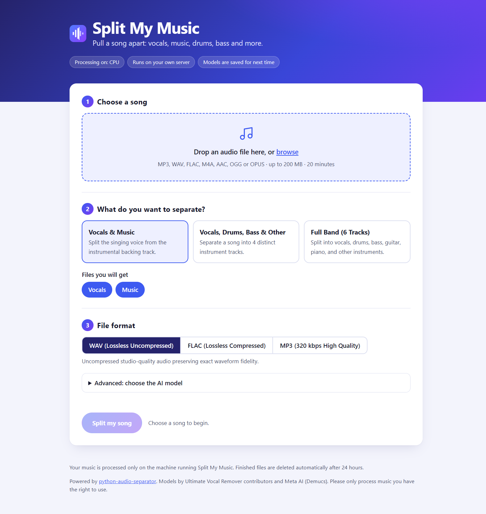
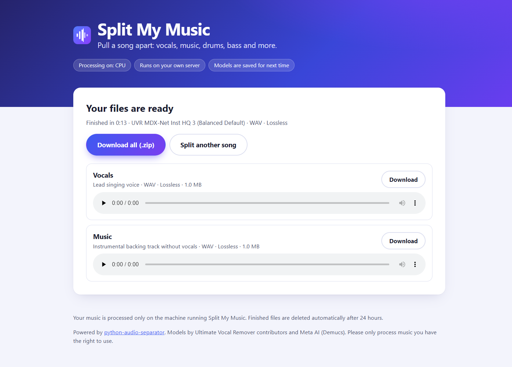

# Split My Music

> Separe uma música em **vocais, instrumental, bateria, baixo e mais** — no seu próprio servidor, com uma página web simples.

🇺🇸 [Read in English](README.md)



O Split My Music é um app web pequeno e self-hosted. Você solta uma música, escolhe o que quer separar, escuta e baixa o resultado. Tudo roda na máquina onde você instalar: **sua música nunca é enviada para terceiros.** A separação em si é feita pela biblioteca open source [python-audio-separator](https://github.com/nomadkaraoke/python-audio-separator); este projeto adiciona uma interface amigável, uma fila de trabalhos segura e configurações Docker para CPU e GPU NVIDIA.

## Funcionalidades

- Upload por arrastar e soltar (MP3, WAV, FLAC, M4A, AAC, OGG, OPUS).
- Três objetivos em linguagem simples: **Vocals & Music**, **Vocals / Drums / Bass / Other**, **Full Band (6 faixas, com guitarra e piano)**.
- Só aparecem as faixas que o modelo escolhido realmente consegue gerar.
- Etapas reais (envio → preparo → modelo → separação → salvar). Sem porcentagem inventada.
- Escute cada faixa na página; baixe uma a uma ou em `.zip`.
- Saída em **WAV** ou **FLAC** (sem perda) ou **MP3** (320 kbps). Mono continua mono e a taxa de amostragem de entrada é mantida (o MP3 usa a taxa suportada mais próxima).
- Avançado: escolha outro modelo testado; veja se já foi baixado e o tamanho do primeiro download.
- Modelos são baixados uma vez e ficam em um volume persistente.
- Seguro por padrão: limites de tamanho/duração, uma música por vez, fila limitada, checagem de disco, limpeza automática e nenhum stack trace para o usuário.
- Responsivo, navegável por teclado, com rótulos para leitores de tela.



## Início rápido (Docker, CPU)

```bash
git clone <este repositório>
cd split-my-music
docker compose up -d --build
```

Abra <http://localhost:7860>. Na primeira vez que cada modelo é usado ele é baixado (50–80 MB nos modelos padrão).

- Os modelos ficam no volume Docker `model-cache`.
- Os resultados ficam em `./data/jobs` no host e são apagados automaticamente após 24 horas.

## Início rápido (GPU NVIDIA)

Requisitos do host: GPU NVIDIA, driver NVIDIA recente e o [NVIDIA Container Toolkit](https://docs.nvidia.com/datacenter/cloud-native/container-toolkit/latest/install-guide.html) configurado no Docker.

```bash
docker compose -f docker-compose.yml -f docker-compose.gpu.yml up -d --build
```

O arquivo de override **substitui** o serviço de CPU, então só um contêiner usa a porta 7860. Não inicie CPU e GPU ao mesmo tempo.

> ⚠️ **Status honesto:** a imagem GPU e o override foram validados apenas com `docker compose config`. **Não foram executados em hardware NVIDIA** (e as imagens Docker também não foram construídas) pelo autor. O caminho de CPU foi testado ponta a ponta fora do Docker. Por favor, reporte problemas. Apple Silicon, AMD e Intel **não** são suportados dentro destes contêineres.

O selo no topo mostra o dispositivo detectado (`CPU` ou `NVIDIA GPU (...)`) e só indica GPU quando o PyTorch enxerga CUDA.

## Atualização

```bash
git pull
docker compose up -d --build        # adicione o -f ... gpu para GPU
```

Modelos e resultados ficam em volumes e sobrevivem às atualizações.

## Modelos

Somente estes modelos testados são expostos (nomes do python-audio-separator):

| Objetivo | Modelo | Arquivos gerados | Primeiro download | Observações |
|---|---|---|---|---|
| Vocals & Music (padrão) | UVR-MDX-NET-Inst_HQ_3 | Vocals, Music | ~64 MB | **Testado em CPU aqui** |
| Vocals & Music | Kim_Vocal_2 | Vocals, Music | ~64 MB | não executado nos testes |
| Vocals & Music | UVR_MDXNET_KARA_2 | Vocals, Music | ~50 MB | mantém backing vocals em Music; não executado nos testes |
| 4 faixas | htdemucs | Vocals, Drums, Bass, Other | ~80 MB | não executado nos testes |
| 6 faixas | htdemucs_6s | + Guitar, Piano | ~53 MB | guitarra/piano podem vazar; não executado nos testes |
| Vocals & Music | BS-RoFormer (ep 317) | Vocals, Music | ~610 MB | muito lento em CPU; GPU recomendada; não executado nos testes |

Apenas o modelo padrão foi realmente executado nos testes automatizados. Os demais foram configurados a partir da lista e dos nomes de arquivo da própria biblioteca, mas não foram executados aqui. Os tamanhos vêm dos servidores dos modelos na data de escrita. Qualidade e velocidade **não foram medidas**.

## Limites e formatos

| Configuração (variável) | Padrão |
|---|---|
| `SPLIT_MAX_UPLOAD_MB` | 200 |
| `SPLIT_MAX_DURATION_MINUTES` | 20 |
| `SPLIT_MAX_CONCURRENT_JOBS` | 1 |
| `SPLIT_MAX_QUEUE_SIZE` | 5 |
| `SPLIT_MIN_FREE_DISK_MB` | 500 (mais o tamanho do modelo se ainda não baixado) |
| `SPLIT_RETENTION_HOURS` | 24 |
| `SPLIT_MAX_STORED_JOBS` | 20 |
| `SPLIT_MODEL_CACHE_DIR` / `SPLIT_JOBS_DIR` | `./data/models` / `./data/jobs` (`/data/...` no Docker) |
| `SPLIT_HOST` / `SPLIT_PORT` / `SPLIT_LOG_LEVEL` | `0.0.0.0` / `7860` / `INFO` |

Arquivos com mais de 2 canais são convertidos para estéreo antes do processamento. Se o servidor reiniciar durante um trabalho, ele é marcado como interrompido e você pode iniciá-lo de novo. A limpeza remove apenas trabalhos finalizados mais antigos que o tempo de retenção (ou acima do limite armazenado), nunca os em andamento.

## Privacidade e segurança

- O processamento acontece no servidor onde você instalou o app. Os arquivos enviados são apagados assim que o trabalho termina; os resultados ficam até o fim da retenção.
- O único tráfego de saída é o download dos arquivos de modelo (GitHub / hosts de modelos) na primeira vez que um modelo é usado.
- Nomes de arquivo nunca viram caminhos; nenhum comando de shell é montado com dados do usuário; os resultados só são servidos por URLs verificadas por trabalho.
- **Não há login.** O app é pensado para seu computador, rede local ou NAS. **Não** exponha na internet como está. Se precisar, use um proxy reverso com HTTPS e autenticação e revise os limites de upload.
- Processe apenas músicas que você tem direito de usar.

## Solução de problemas

- **"Falha no download do modelo"** – o servidor precisa de internet para o GitHub na primeira vez e de espaço em disco. Tente novamente.
- **"Memória insuficiente"** – use o modelo padrão ou uma música mais curta.
- **Selo mostra CPU com GPU instalada** – o contêiner não enxerga a GPU. Verifique `nvidia-smi` no host e o NVIDIA Container Toolkit.
- **"Servidor ocupado"** – a fila está cheia; aguarde uma música terminar.
- **Contêiner unhealthy** – `docker compose logs split-my-music`; o health check é `GET /health`.
- Lentidão em CPU é normal para músicas longas; modelos maiores são bem mais lentos.

## Desenvolvimento

Requer Python 3.12 e FFmpeg.

```bash
python3.12 -m venv .venv
.venv/bin/pip install -r requirements.txt     # Windows: .venv\Scripts\pip
.venv/bin/python main.py
```

Testes:

```bash
pytest -m "not real_model"     # rápidos: unitários + integração com motor falso
pytest -m real_model           # baixa ~64 MB e roda o modelo real em CPU
pytest                         # tudo
```

Estrutura: `src/core/engine.py` é o único ponto que fala com o python-audio-separator; `catalog.py` lista os modelos testados; `jobs.py` cuida da fila; `routes.py` é a API web. As specs ficam em `.specs/`.

## Licença e créditos

Código: [MIT](LICENSE). Os pesos dos modelos e as dependências têm **licenças próprias** e são baixados em tempo de execução, não distribuídos aqui:

- [python-audio-separator](https://github.com/nomadkaraoke/python-audio-separator) (MIT) por Andrew Beveridge / nomadkaraoke. Pede que projetos que usam modelos UVR deem crédito ao UVR e seus desenvolvedores.
- [Ultimate Vocal Remover](https://github.com/Anjok07/ultimatevocalremovergui) por Anjok07 e aufr33 e os modelos MDX-Net (KimberleyJSN, Kuielab e outros).
- [Demucs](https://github.com/facebookresearch/demucs) da Meta AI Research (MIT).
- Implementações BS-RoFormer de lucidrains e pesos de ViperX.
- FFmpeg (LGPL/GPL conforme o build), PyTorch, ONNX Runtime, FastAPI.

As notas de licença no app e acima são um resumo de boa-fé das páginas dos projetos; verifique a licença de cada arquivo de modelo antes de redistribuí-lo. Inspirado no layout do [voice-separator-demucs](https://github.com/paladini/voice-separator-demucs).
